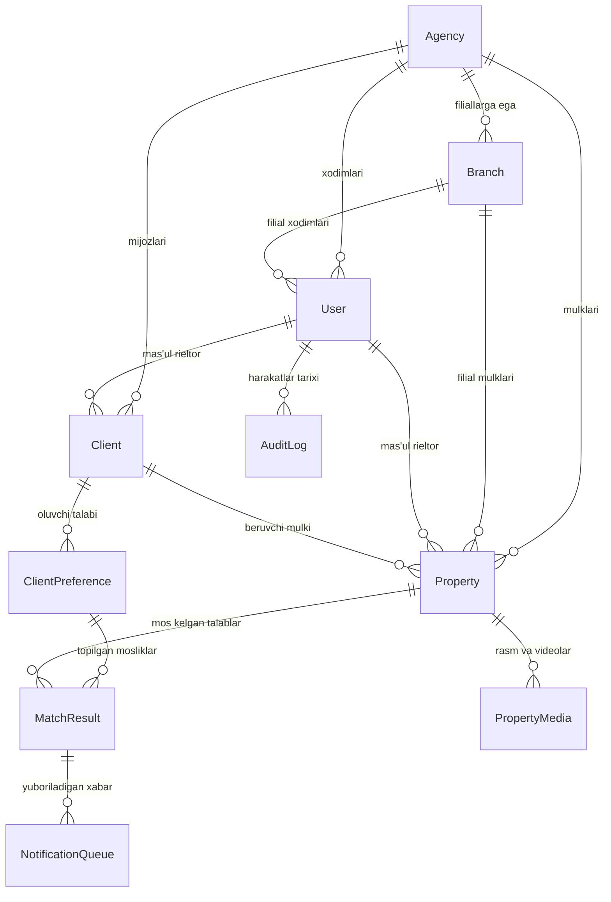

# Database Schema & Model Arxitekturasi (PostgreSQL + Prisma)

> **Hujjat:** docs/02_database_schema.md  
> **Tizim:** Multi-tenant Realtor CRM/ERP  
> **DB Engine:** PostgreSQL 16+ (PostGIS bilan)

---

## 1. ERD (Entity Relationship Diagram) Umumiy Ko'rinishi



---

## 2. To'liq Prisma Schema (prisma.schema)

Quyida tizimning to'liq relatsion bazasi modeli keltirilgan:

```prisma
datasource db {
  provider = "postgresql"
  url      = env("DATABASE_URL")
}

generator client {
  provider = "prisma-client-js"
}

// ----------------------------------------------------
// 1. TENANT & TASHKILIY TUZILMA
// ----------------------------------------------------

enum AgencyPlan {
  STARTER
  PRO
  ENTERPRISE
}

model Agency {
  id              String         @id @default(uuid())
  name            String         @db.VarChar(150)
  slug            String         @unique @db.VarChar(50) // subdomain yoki mini-app slug
  phone           String         @db.VarChar(30)
  email           String?        @db.VarChar(100)
  logoUrl         String?
  plan            AgencyPlan     @default(STARTER)
  isActive        Boolean        @default(true)
  settings        Json?          // SMS provayder (Eskiz api key), Telegram bot token
  createdAt       DateTime       @default(now())
  updatedAt       DateTime       @updatedAt

  branches        Branch[]
  users           User[]
  properties      Property[]
  clients         Client[]
  auditLogs       AuditLog[]

  @@map("agencies")
}

model Branch {
  id              String         @id @default(uuid())
  agencyId        String
  name            String         @db.VarChar(120)
  address         String?
  phone           String?        @db.VarChar(30)
  createdAt       DateTime       @default(now())
  updatedAt       DateTime       @updatedAt

  agency          Agency         @relation(fields: [agencyId], references: [id], onDelete: Cascade)
  users           User[]
  properties      Property[]

  @@map("branches")
}

// ----------------------------------------------------
// 2. FOYDALANUVCHILAR VA XODIMLAR (RBAC)
// ----------------------------------------------------

enum Role {
  SUPER_ADMIN
  AGENCY_ADMIN
  BRANCH_MANAGER
  REALTOR
}

model User {
  id              String         @id @default(uuid())
  agencyId        String
  branchId        String?
  role            Role           @default(REALTOR)
  fullName        String         @db.VarChar(100)
  phone           String         @unique @db.VarChar(30)
  email           String?        @unique @db.VarChar(100)
  passwordHash    String
  telegramId      BigInt?        @unique
  telegramUsername String?       @db.VarChar(50)
  avatarUrl       String?
  isActive        Boolean        @default(true)
  createdAt       DateTime       @default(now())
  updatedAt       DateTime       @updatedAt

  agency          Agency         @relation(fields: [agencyId], references: [id], onDelete: Cascade)
  branch          Branch?        @relation(fields: [branchId], references: [id], onDelete: SetNull)
  properties      Property[]     @relation("RealtorProperties")
  clients         Client[]       @relation("RealtorClients")
  auditLogs       AuditLog[]

  @@index([agencyId, role])
  @@map("users")
}

// ----------------------------------------------------
// 3. MIJOZLAR (OLUVCHI VA BERUVCHI)
// ----------------------------------------------------

enum ClientType {
  BUYER         // Sotib oluvchi
  TENANT        // Ijaraga oluvchi
  SELLER        // Mulkini sotuvchi
  LANDLORD      // Mulkini ijaraga beruvchi
}

enum ClientStatus {
  LEAD          // Yangi so'rov
  ACTIVE        // Qidiruvda yoki muzokarada
  IN_DEAL       // Bitim jarayonida
  COMPLETED     // Bitim yakunlangan
  ARCHIVED      // Rad etilgan / To'xtatilgan
}

model Client {
  id              String         @id @default(uuid())
  agencyId        String
  realtorId       String
  clientType      ClientType
  status          ClientStatus   @default(LEAD)
  fullName        String         @db.VarChar(100)
  phone           String         @db.VarChar(30)
  secondaryPhone  String?        @db.VarChar(30)
  telegramId      BigInt?
  telegramUsername String?       @db.VarChar(50)
  notes           String?        @db.Text
  createdAt       DateTime       @default(now())
  updatedAt       DateTime       @updatedAt

  agency          Agency         @relation(fields: [agencyId], references: [id], onDelete: Cascade)
  realtor         User           @relation("RealtorClients", fields: [realtorId], references: [id], onDelete: Restrict)
  properties      Property[]     @relation("OwnerProperties") // Beruvchi bo'lsa
  preferences     ClientPreference? // Oluvchi bo'lsa talablari

  @@index([agencyId, phone])
  @@index([realtorId, status])
  @@map("clients")
}

// Oluvchi (Buyer / Tenant) uchun qidiruv talablari
model ClientPreference {
  id              String         @id @default(uuid())
  clientId        String         @unique
  dealType        DealType       // SALE yoki RENT
  propertyType    PropertyType   // APARTMENT, HOUSE, COMMERCIAL, LAND
  minPrice        Decimal        @db.Decimal(12, 2)
  maxPrice        Decimal        @db.Decimal(12, 2)
  currency        Currency       @default(USD)
  rooms           Int[]          // Masalan: [2, 3] xonali
  regions         String[]       // Shahar / Viloyat ro'yxati
  districts       String[]       // Tumanlar (Chilonzor, Mirzo Ulug'bek va h.k.)
  minArea         Float?         // Min kv.m
  maxArea         Float?         // Max kv.m
  minFloor        Int?
  maxFloor        Int?
  renovationTypes Renovation[]   // Yevro, O'rtacha, va h.k.
  hasMortgage     Boolean?       // Ipoteka talab qilinadimi?
  autoNotifySms   Boolean        @default(true) // Mos uy chiqsa avto SMS jo'natilsinmi?
  autoNotifyTg    Boolean        @default(true) // Mos uy chiqsa avto Telegram jo'natilsinmi?
  createdAt       DateTime       @default(now())
  updatedAt       DateTime       @updatedAt

  client          Client         @relation(fields: [clientId], references: [id], onDelete: Cascade)
  matches         MatchResult[]

  @@map("client_preferences")
}

// ----------------------------------------------------
// 4. MULKLAR (PROPERTIES)
// ----------------------------------------------------

enum DealType {
  SALE
  RENT_LONG
  RENT_DAILY
}

enum PropertyType {
  APARTMENT
  HOUSE
  COMMERCIAL
  LAND
  NEW_BUILDING
}

enum Currency {
  USD
  UZS
}

enum Renovation {
  EURO
  GOOD
  MEDIUM
  ROUGH_FINISH  // Qora suvoq
  NEEDS_REPAIR  // Ta'mirtalab
}

enum PropertyStatus {
  DRAFT
  ACTIVE
  RESERVED
  SOLD
  RENTED
  ARCHIVED
}

model Property {
  id              String         @id @default(uuid())
  agencyId        String
  branchId        String?
  realtorId       String
  ownerId         String?        // Mulk egasi (Client - Seller/Landlord)
  
  dealType        DealType
  propertyType    PropertyType
  status          PropertyStatus @default(ACTIVE)

  title           String         @db.VarChar(200)
  description     String         @db.Text
  price           Decimal        @db.Decimal(12, 2)
  currency        Currency       @default(USD)
  isNegotiable    Boolean        @default(true) // Kelishsa bo'ladimi?

  rooms           Int
  floor           Int?
  totalFloors     Int?
  areaTotal       Float          // Umumiy maydoni kv.m
  areaLiving      Float?         // Yashash maydoni
  renovation      Renovation     @default(MEDIUM)
  buildingType    String?        // Panel, G'isht, Monolit
  builtYear       Int?

  // Manzil & Geolokatsiya
  region          String         @db.VarChar(80)   // Toshkent sh.
  district        String         @db.VarChar(80)   // Yunusobod
  addressLine     String         @db.VarChar(255)  // Ts-4, 15-uy
  landmark        String?        @db.VarChar(150)  // Mo'ljal
  latitude        Float?
  longitude       Float?

  // Qo'shimcha qulayliklar
  hasElevator     Boolean        @default(false)
  hasParking      Boolean        @default(false)
  hasFurniture    Boolean        @default(false)
  hasGas          Boolean        @default(true)

  viewCount       Int            @default(0)
  createdAt       DateTime       @default(now())
  updatedAt       DateTime       @updatedAt

  agency          Agency         @relation(fields: [agencyId], references: [id], onDelete: Cascade)
  branch          Branch?        @relation(fields: [branchId], references: [id], onDelete: SetNull)
  realtor         User           @relation("RealtorProperties", fields: [realtorId], references: [id], onDelete: Restrict)
  owner           Client?        @relation("OwnerProperties", fields: [ownerId], references: [id], onDelete: SetNull)
  media           PropertyMedia[]
  matches         MatchResult[]

  @@index([agencyId, status, dealType, propertyType])
  @@index([price, currency])
  @@index([region, district, rooms])
  @@map("properties")
}

model PropertyMedia {
  id              String         @id @default(uuid())
  propertyId      String
  url             String
  thumbnailUrl    String?
  fileType        String         @default("image") // image, video
  sortOrder       Int            @default(0)
  isCover         Boolean        @default(false)
  createdAt       DateTime       @default(now())

  property        Property       @relation(fields: [propertyId], references: [id], onDelete: Cascade)

  @@index([propertyId, sortOrder])
  @@map("property_media")
}

// ----------------------------------------------------
// 5. SMART MATCHING VA XABARNOMALAR
// ----------------------------------------------------

enum MatchStatus {
  PENDING         // Aniqlangan, hali xabar ketmagan
  NOTIFIED        // Xabar (SMS / TG) jo'natildi
  VIEWED          // Mijoz ochib ko'rdi
  ACCEPTED        // Mijozga yoqdi, ko'rishga bordi
  REJECTED        // Mijozga to'g'ri kelmadi
}

model MatchResult {
  id              String         @id @default(uuid())
  preferenceId    String
  propertyId      String
  matchScore      Int            // 0 - 100% moslik ko'rsatkichi
  matchReasons    Json?          // Qaysi parametrlar bo'yicha mos kelgani tahlili
  status          MatchStatus    @default(PENDING)
  notifiedAt      DateTime?
  createdAt       DateTime       @default(now())

  preference      ClientPreference @relation(fields: [preferenceId], references: [id], onDelete: Cascade)
  property        Property         @relation(fields: [propertyId], references: [id], onDelete: Cascade)
  notifications   NotificationQueue[]

  @@unique([preferenceId, propertyId])
  @@index([status, matchScore])
  @@map("match_results")
}

enum NotificationChannel {
  SMS
  TELEGRAM_BOT
  TELEGRAM_MINI_APP_PUSH
}

enum QueueStatus {
  QUEUED
  PROCESSING
  SENT
  FAILED
}

model NotificationQueue {
  id              String              @id @default(uuid())
  matchResultId   String?
  recipientPhone  String              @db.VarChar(30)
  recipientTgId   BigInt?
  channel         NotificationChannel
  messageContent  String              @db.Text
  targetUrl       String?             // Mini-app link: t.me/bot?startapp=...
  status          QueueStatus         @default(QUEUED)
  attempts        Int                 @default(0)
  lastError       String?
  scheduledFor    DateTime            @default(now())
  sentAt          DateTime?
  createdAt       DateTime            @default(now())

  matchResult     MatchResult?        @relation(fields: [matchResultId], references: [id], onDelete: SetNull)

  @@index([status, scheduledFor])
  @@map("notification_queues")
}

// ----------------------------------------------------
// 6. AUDIT VA XAVFSIZLIK JURNALI (AUDIT LOGS)
// ----------------------------------------------------

enum AuditAction {
  CREATE
  UPDATE
  DELETE
  VIEW_PHONE
  EXPORT
  LOGIN
}

model AuditLog {
  id              String         @id @default(uuid())
  agencyId        String
  userId          String?
  action          AuditAction
  entityName      String         @db.VarChar(50) // Property, Client, User
  entityId        String?
  details         Json?          // O'zgargan qiymatlar (Old vs New)
  ipAddress       String?        @db.VarChar(45)
  userAgent       String?
  createdAt       DateTime       @default(now())

  agency          Agency         @relation(fields: [agencyId], references: [id], onDelete: Cascade)
  user            User?          @relation(fields: [userId], references: [id], onDelete: SetNull)

  @@index([agencyId, createdAt])
  @@index([entityName, entityId])
  @@map("audit_logs")
}
```

---

## 3. Asosiy Indekslar va Hosildorlik (Indexing Strategy)

* `properties(agencyId, status, dealType, propertyType)`: Barcha ro'yxat va mini-app katalog filtrlari uchun birlashtirilgan indeks.
* `properties(price, currency)`: Byudjet bo'yicha tezkor oraliq so'rovlari (`BETWEEN :min AND :max`).
* `match_results(preferenceId, propertyId)`: Unikal cheklov bir xil mulk va xaridor o'rtasida takroriy hisoblashlarni oldini oladi.
* `notification_queues(status, scheduledFor)`: Fon jarayoni (Redis/BullMQ) kutayotgan SMS va xabarlarni mikrosoniyalarda olib ketishi uchun.
