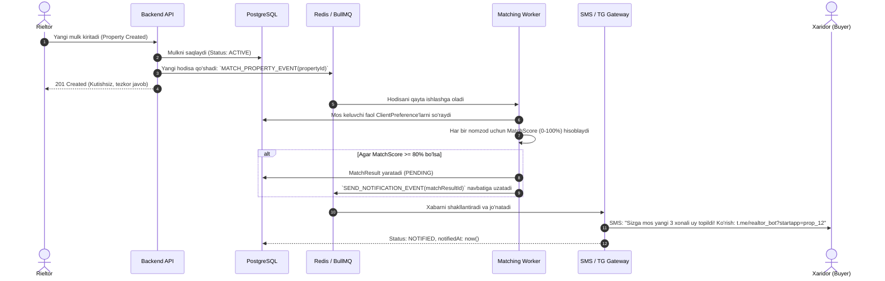

# Smart Matching Engine & Avtomatlashtirilgan Xabarnoma Tizimi

> **Hujjat:** docs/03_smart_matching_engine.md  
> **Arxitektura darajasi:** High-Performance Event-Driven Matching

---

## 1. Dvigatelning Maqsadi va Ishlash Prinsipi

Audioda ta'kidlangan asosiy biznes qiymati:
> *"Mijoz keldi, 3 xonali uy kerak dedi, telefon raqamini qoldirdi. Lekin bugun unga mos uy yo'q. Oradan 3 kun o'tib yangi uy kiritildi. Tizim avtomatik tarzda: 'Bu uy mana bu mijozga to'g'ri keladi!' deb xulosa chiqarishi va to'g'ridan-to'g'ri o'sha mijozga SMS/Telegram orqali xabar jo'natishi kerak."*

---

## 2. Event-Driven Matching Oqimi (Workflow Diagrammasi)



---

## 3. Moslik Ballini Hisoblash Algoritmi (Matching Scoring Formula)

Mulk va Xaridor talabi o'rtasidagi umumiy ball $S_{total} \in [0, 100]$ quyidagi vaznli ko'rsatkichlar asosida hisoblanadi:

$$S_{total} = w_{deal} \cdot S_{deal} + w_{type} \cdot S_{type} + w_{loc} \cdot S_{loc} + w_{price} \cdot S_{price} + w_{rooms} \cdot S_{rooms} + w_{area} \cdot S_{area} + w_{renov} \cdot S_{renov}$$

### Vazn Koeffitsiyentlari:
* **Bitim turi ($w_{deal} = 25\%$):** Qat'iy shart. Agar biri Sotuv, biri Ijara bo'lsa, ball darhol 0 bo'ladi.
* **Mulk turi ($w_{type} = 15\%$):** Masalan: Kvartira kvartiraga to'g'ri kelsa = 100%.
* **Joylashuv ($w_{loc} = 25\%$):**
  * Tuman mos kelsa: 100%
  * Shahar bir xil, lekin tuman boshqa: 30%
* **Narx / Byudjet ($w_{price} = 20\%$):**
  * Agar mulk narxi mijozning `[minPrice, maxPrice]` oralig'iga tushsa: 100%
  * Agar narx mijoz maksimal byudjetidan 5% gacha baland bo'lsa (savdolashish hisobiga): 70%
  * 10% gacha yuqori bo'lsa: 40%
  * 10% dan baland bo'lsa: 0%
* **Xonalar soni ($w_{rooms} = 15\%$):**
  * Agar xonalar soni mijoz xohlagan massivda (`rooms: [2, 3]`) bo'lsa: 100%
  * $\pm 1$ xona farq qilsa: 40%

### Chegara shartlari (Threshold):
* **Minimal xabarnoma chegarasi:** $S_{total} \ge 80\%$.
* 80% dan past bo'lgan mulklar mijozga xalaqit bermaslik uchun avtomatik SMS qilinmaydi, faqat rieltorning kabinetida "Tavsiya etilishi mumkin bo'lgan uylar" ro'yxatida ko'rinadi.

---

## 4. Reverse Matching (Teskari Moslashtirish)

Tizimda ikki xil trigger mavjud:

1. **Forward Matching (Xaridor kiritilganda):**
   * Yangi xaridor keldi -> Uning talablari saqlandi -> Bazadagi mavjud 1,000+ ta mulk bilan taqqoslanadi -> Rieltorga shu zahotiyoq mos uylar ro'yxati chiqadi.
2. **Reverse Matching (Yangi mulk kiritilganda yoki narx arzonlashganda):**
   * Yangi uy kiritildi (yoki mulk egasi narxni $60,000 dan $52,000 ga tushirdi).
   * Tizim bazadagi barcha faol xaridorlarning talablarini skaner qiladi.
   * Ushbu yangi narx yoki uyga to'g'ri keladigan mijozlar ro'yxatini shakllantiradi va ularga avtomatik xabar yo'llaydi.

---

## 5. Xabarnoma Shabloni va Anti-Spam Himoyasi

### SMS Xabarnoma Matni Shabloni:
```text
Hurmatli {MijozIsmi}! Siz qidirgan talablar bo'yicha yangi mulk qo'shildi:
📍 {Tuman}, {Xonalar}-xona, {Maydoni} kv.m.
💰 Narxi: ${Narxi}
📸 Rasmlarni ko'rish: https://t.me/{BotUsername}?startapp=p_{PropertyId}
Rieltor: {RieltorIsmi} ({RieltorTelefon})
```

### Anti-Spam va Xavfsizlik Qoidalari:
1. **Mijozni bezovta qilmaslik (Cool-down):** Bitta mijozga 24 soat ichida ko'pi bilan 2 tadan ortiq avtomatik SMS yuborilmaydi.
2. **Tungi jimlik (Quiet Hours):** Soat 21:00 dan ertalab 09:00 gacha SMS yuborish kechiktiriladi (Scheduled Queue). Ertalab soat 09:05 da navbat bilan yuboriladi.
3. **Opt-out (Obunani bekor qilish):** Mijoz o'ziga xabar kelishini to'xtatish huquqiga ega (`autoNotifySms: false`).
